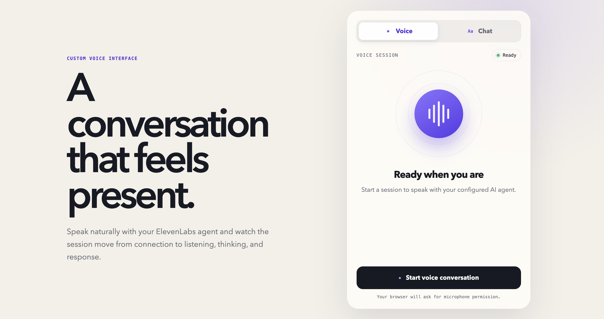
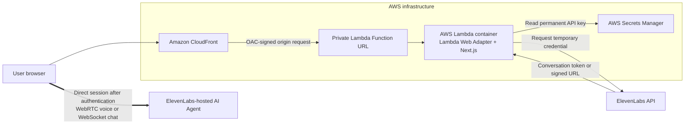
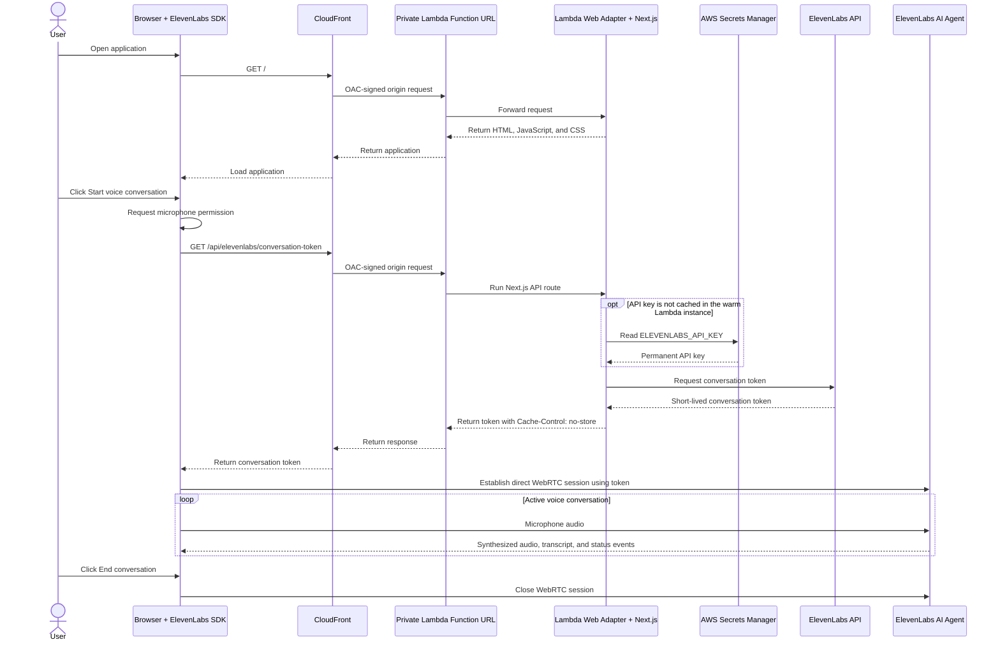
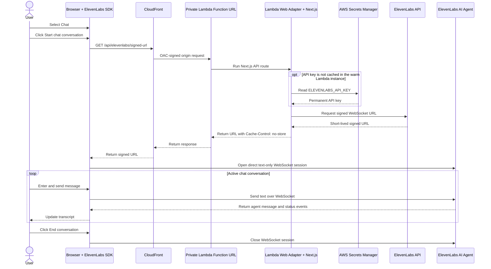
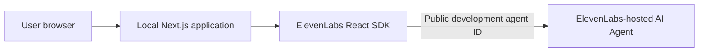

# Voxline — ElevenLabs Agent Demo

Voxline is a custom web interface for real-time voice and text conversations
with an [ElevenLabs AI Agent](https://elevenlabs.io/docs/eleven-agents/overview).
It demonstrates how to combine an ElevenLabs-hosted conversational agent with a
Next.js application that can be packaged for AWS Lambda.

ElevenLabs hosts and operates the AI Agent, including the conversation runtime,
voice, speech processing, model configuration, prompt, knowledge base, and
tools configured in the ElevenLabs platform. This repository provides the web
interface, creates short-lived production credentials, and contains optional
AWS deployment packaging.

> This is a reference/demo project. Before exposing it publicly, add visitor
> authentication and rate limiting to the credential endpoints.

## User interface

The application lets a user choose voice or text chat, start and end a session,
view the transcript, mute a voice session, and inspect basic latency measurements.



## Architecture

### AWS production overview



CloudFront signs the origin request to the private Lambda Function URL using
Origin Access Control (OAC); the user's browser does not create that AWS
signature. Next.js runs inside the Lambda container through Lambda Web Adapter,
not as a separate compute service.

In production, the AWS application path serves the interface and obtains a
temporary ElevenLabs credential. After that credential is returned, the browser
connects directly to ElevenLabs. CloudFront and Lambda do not proxy the live
audio or chat stream.

### Voice conversation flow



The application requests microphone permission before it asks the ElevenLabs
React SDK to start the WebRTC session. The initial permission-check stream is
closed immediately; the SDK manages microphone access during the active
conversation.

### Chat conversation flow



Chat mode does not request microphone permission. Both modes use AWS only to
obtain the short-lived credential; the ongoing session is between the browser
and ElevenLabs.

### Local development flow



Local development does not use CloudFront, Lambda, Secrets Manager, or the two
credential routes. The browser uses `ELEVENLABS_DEV_AGENT_ID` to connect to the
public development agent directly.

## Solutions used

| Responsibility | Solution |
| --- | --- |
| AI Agent, conversation runtime, voice, speech processing, prompt, knowledge base, and agent tools | ElevenLabs Agents Platform |
| Browser conversation SDK | `@elevenlabs/react` |
| Web interface and server-side credential endpoints | Next.js, React, and TypeScript |
| Application runtime | Node.js 22 |
| Production API-key source | Local environment for testing, or AWS Secrets Manager for AWS deployment |
| Optional production compute | AWS Lambda container with AWS Lambda Web Adapter |
| Container packaging | Docker |
| Automated validation | GitHub Actions |

The ElevenLabs agent definition is not stored in this repository. To reproduce
the complete experience, create or configure an agent in ElevenLabs separately
and supply its agent ID through environment variables.

## Development and production behavior

- **Development:** the browser connects directly to a public ElevenLabs test
  agent using `ELEVENLABS_DEV_AGENT_ID`.
- **Production:** the browser requests a WebRTC conversation token for voice or
  a signed WebSocket URL for chat. Server-side routes use
  `ELEVENLABS_PROD_AGENT_ID` and the permanent API key, which is never sent to
  the browser.
- **AWS:** when `ELEVENLABS_API_KEY` is absent, the server retrieves it from the
  AWS Secrets Manager secret identified by `ELEVENLABS_SECRET_ARN`.

## Prerequisites

- Node.js 22.13 or newer
- npm
- An ElevenLabs account
- A public ElevenLabs agent for local development
- An ElevenLabs API key and a private agent for production-mode testing
- Optional: Docker and AWS resources for Lambda deployment

## Configure the ElevenLabs agents

Agent configuration lives in ElevenLabs and is not created by this repository.
Before running the application:

1. Create an agent in the ElevenLabs Agents dashboard.
2. Configure its system instructions, first message, voice, knowledge base, and
   tools for your use case.
3. For local development, use a public agent and copy its ID into
   `ELEVENLABS_DEV_AGENT_ID`.
4. For production, create or configure a private agent that requires
   authentication and copy its ID into `ELEVENLABS_PROD_AGENT_ID`.
5. Create an ElevenLabs API key only when testing or deploying the private-agent
   flow. Keep that key server-side.

Voice and text sessions share the selected ElevenLabs agent. The application
sets text-only mode when the user selects Chat.

## Get started locally

1. Clone the repository and install dependencies:

   ```bash
   npm ci
   ```

2. Copy the environment template:

   ```bash
   cp .env.example .env
   ```

3. Set at least the development agent ID:

   ```dotenv
   ELEVENLABS_DEV_AGENT_ID=your_public_development_agent_id
   ```

4. Start the development server:

   ```bash
   npm run dev
   ```

5. Open [http://localhost:3000](http://localhost:3000).

Your browser will request microphone access when you start a voice conversation.
Text chat does not require microphone permission.

## Environment variables

| Variable | Required | Purpose |
| --- | --- | --- |
| `ELEVENLABS_DEV_AGENT_ID` | Development | Public agent used directly by the browser during `npm run dev` |
| `ELEVENLABS_PROD_AGENT_ID` | Production | Private agent used when creating short-lived credentials |
| `ELEVENLABS_API_KEY` | Local production-mode test | Server-side ElevenLabs API key; never prefix it with `NEXT_PUBLIC_` |
| `ELEVENLABS_SECRET_ARN` | AWS production | ARN of a JSON secret containing `ELEVENLABS_API_KEY` |

For an AWS deployment, the secret value must be JSON:

```json
{
  "ELEVENLABS_API_KEY": "your_server_side_api_key"
}
```

Do not commit `.env` files or permanent API keys. The included ignore files
exclude them from Git and Docker build contexts.

## Production-mode test

Add `ELEVENLABS_API_KEY` and `ELEVENLABS_PROD_AGENT_ID` to `.env`, then run:

```bash
npm run build
npm run start
```

Production mode exercises the server-side token and signed-URL routes while
keeping the permanent ElevenLabs API key off the client.

## AWS deployment packaging

The included Dockerfile packages the standalone Next.js server for an ARM64 AWS
Lambda container using AWS Lambda Web Adapter. The Lambda execution role needs
`secretsmanager:GetSecretValue` permission for the exact secret configured by
`ELEVENLABS_SECRET_ARN`.

This repository contains application packaging, not a complete AWS environment.
It does not create ECR, Lambda, IAM, Secrets Manager, CloudFront, DNS, or network
resources. Provision those separately before enabling deployment automation.

The GitHub Actions AWS publishing job is currently commented out. Pull requests
and pushes still run the validation job, but no image is published and no Lambda
function is updated automatically.

To prepare an image manually:

```bash
docker buildx build \
  --platform linux/arm64 \
  --provenance=false \
  --load \
  -t voxline-elevenlabs-agent-demo:local .
```

## Security considerations

- The permanent ElevenLabs API key remains server-side.
- Credential responses use `Cache-Control: no-store`.
- Calls from the server to ElevenLabs have a 10-second timeout and sanitized
  client-facing errors.
- The current credential endpoints do not authenticate website visitors or
  enforce rate limits. Add both controls before public production use.
- AWS infrastructure controls such as CloudFront or Lambda Function URL access
  do not replace application-level visitor authentication.

## Data handling

- Browser microphone audio, user messages, agent responses, and conversation
  metadata are transmitted to ElevenLabs as part of the conversation.
- This application keeps the visible transcript only in browser memory for the
  current page session; it does not write transcripts to a local database.
- ElevenLabs-side retention and processing depend on the settings and terms of
  the ElevenLabs workspace and agent. Review those settings before processing
  personal or sensitive data.
- Do not log temporary credentials, API keys, or sensitive transcript content.

## Available commands

| Command | Description |
| --- | --- |
| `npm run dev` | Start the local development server |
| `npm run lint` | Run ESLint |
| `npm run typecheck` | Check TypeScript without emitting files |
| `npm test` | Run the project tests |
| `npm run build` | Create the production Next.js build |
| `npm run check` | Run lint, typecheck, tests, and production build |

## Project structure

```text
app/
  api/elevenlabs/       Server-only credential endpoints
  globals.css           Application styling
  layout.tsx            Root document and metadata
  page.tsx              Environment selection and page layout
  voice-agent.tsx       ElevenLabs React SDK integration and UI
lib/
  elevenlabs.ts         Shared credential and Secrets Manager logic
public/
  screenshots/          README interface image
  favicon.svg
tests/
  project.test.mjs      Architecture and packaging checks
.github/workflows/
  ci-cd.yml             CI validation; AWS publishing currently disabled
Dockerfile              Optional AWS Lambda container image
run.sh                  Standalone Next.js container startup command
```

## Current scope

The project intentionally does not include user authentication, persistent
transcript storage, a database, CRM integration, MCP servers, or the source
configuration of the ElevenLabs agent. Those capabilities can be added based
on the deployment's requirements.

## License

This project is available under the [MIT License](LICENSE).
